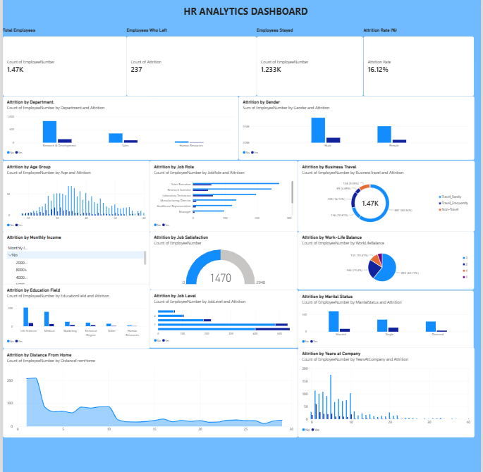

# HR Analytics Dashboard

An interactive Power BI dashboard analyzing employee attrition and workforce trends across 1,470 employees, built to help HR teams see who is leaving and why.

## Business Questions
- What is the overall attrition rate, and how many employees left versus stayed?
- Which departments, job roles, and age groups lose the most employees?
- Does overtime, marital status, gender, or education field relate to attrition?

## Tools Used
Power BI | DAX

## Key Numbers
| KPI | Value |
|---|---|
| Total Employees | 1,470 |
| Employees Who Left | 237 |
| Employees Who Stayed | 1,233 |
| Attrition Rate | 16.12% |

## Key Insights
- **Overtime is the strongest signal:** 30.5% of employees who work overtime left, compared with 10.4% of those who don't.
- **Sales Representatives have the highest attrition by job role:** 39.8% (33 of 83), followed by Laboratory Technicians at 23.9%.
- **Sales is the department with the highest attrition:** 20.6%, versus 13.8% in Research & Development.
- **Younger employees leave more:** attrition is 35.8% for employees aged 25 or under and 19.1% for ages 26 to 35, falling to about 9% for ages 36 to 45.
- **Single employees leave at twice the rate of married employees:** 25.5% versus 12.5%.

These insights can help HR teams focus retention efforts on overtime workload, sales roles, and early-career employees.

## How It Was Built
- Created KPI cards for total employees, employees who left, employees who stayed, and attrition rate.
- Built charts for attrition by department, gender, age group, job role, overtime, education field, and marital status.
- Used **DAX** to calculate the attrition rate and to create calculated columns for age groups and monthly income groups.

## Files in this Repository
| File | Description |
|---|---|
| `HR_Analytics_Dashboard.pbix` | Power BI dashboard |
| `HR_Analytics_Cleaned.csv` | Cleaned HR attrition dataset (1,470 rows, 35 columns) |
| `dashboard.png` | Dashboard screenshot |

## Dataset
IBM HR Analytics Employee Attrition & Performance dataset from [Kaggle](https://www.kaggle.com/datasets/pavansubhasht/ibm-hr-analytics-attrition-dataset) (1,470 employees, 35 columns).

## How to Open
Download the `.pbix` file and open it in Power BI Desktop.

## Author
Mohammed Muzammil | [LinkedIn](https://linkedin.com/in/mmuzammil39) | muzammilmohammad330@gmail.com
